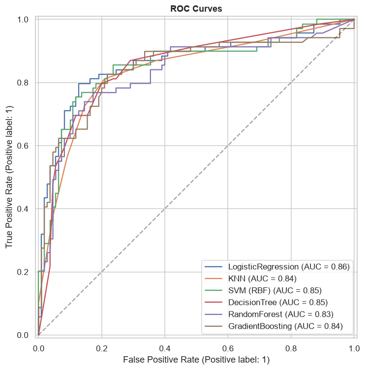
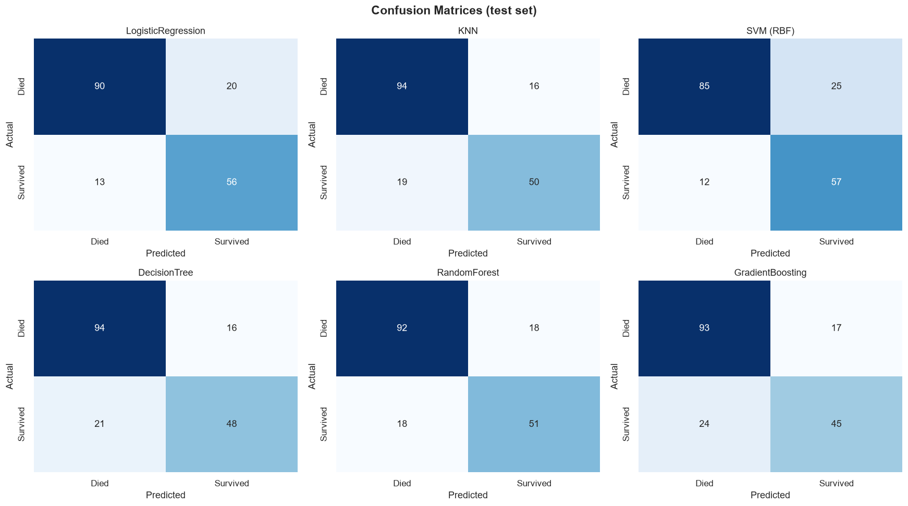
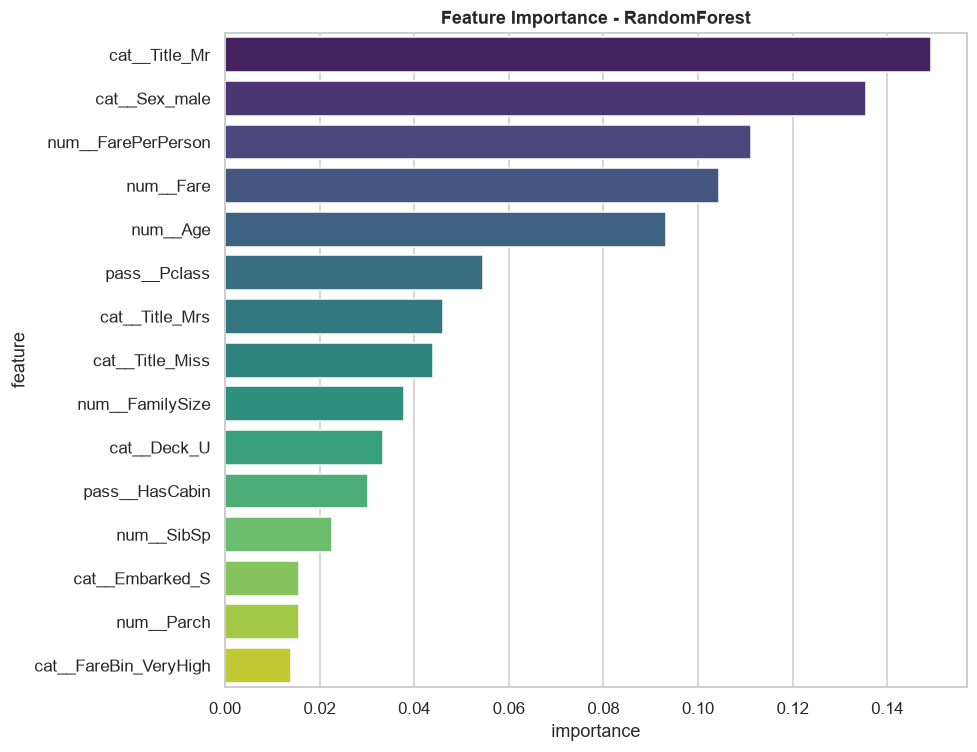

# titanic-ml

A full machine-learning cycle on the classic Titanic dataset: from raw data to a
saved model that predicts survival for a single passenger.

Binary classification, 891 passengers, 6 algorithms compared, the best two tuned
with GridSearchCV.

## Pipeline

The script runs the whole project end to end, printing every stage to the console:

1. **Problem definition** — predict `Survived` (0/1); accuracy as the primary metric,
   F1 and ROC-AUC added because the classes are imbalanced (~62/38).
2. **Data collection** — the dataset is downloaded once and cached locally, so later
   runs work offline.
3. **Cleaning** — `Age` is filled with the median of its `Title` × `Pclass` group and
   falls back to the global median; `Embarked` with the mode; `Cabin` (77% missing) is
   not imputed but converted into `Deck` and a `HasCabin` flag.
4. **EDA** — survival rates by sex, class, port and title; distribution plots.
5. **Feature engineering** — `Title` extracted from the name with a regular expression,
   `FamilySize`, `IsAlone`, `FarePerPerson`, `AgeBin`, `FareBin`.
6. **Model selection** — LogisticRegression, SVM, KNN, DecisionTree, RandomForest and
   GradientBoosting, each inside a `Pipeline` with a `ColumnTransformer`
   (scaling for numeric features, one-hot encoding for categorical ones), compared with
   5-fold stratified cross-validation.
7. **Evaluation** — accuracy, precision, recall, F1, ROC-AUC, confusion matrices,
   ROC curves.
8. **Fine-tuning** — `GridSearchCV` over both ensembles; the better CV score wins.
9. **Deployment** — the fitted pipeline is saved with `joblib`, plus a
   `predict_passenger()` function that takes raw passenger fields, derives the engineered
   features itself and returns a survival probability.
10. **Summary** — key findings and a comparison table of every model.

## Tech

`pandas`, `NumPy`, `scikit-learn` (pipelines, ColumnTransformer, GridSearchCV,
StratifiedKFold), `Matplotlib`, `Seaborn`, `joblib`

## Details worth mentioning

- **Preprocessing lives inside the pipeline**, not in the dataframe. Scaling and encoding
  are fitted on the training folds only, so cross-validation scores are not inflated by
  data leaking from the validation fold.
- **Imbalance** is handled with `class_weight='balanced'` for LogisticRegression and SVM.
- **Reproducibility** — a single `RANDOM_STATE` is used for the split, the models and the
  cross-validation.
- **Feature importance** is read from `feature_importances_` when the final model exposes
  it and from `coef_` when it does not, so the report works whichever model wins.

  ## Results







## How to run

```bash
pip install -r requirements.txt
python titanic_project.py
```

Everything the run produces — plots, the comparison table and `titanic_model.pkl` —
is written to an `outputs/` folder next to the script.

## Predicting for one passenger

```python
predict_passenger(final_model, Pclass=1, Sex='female', Age=30, Fare=100,
                  Title='Mrs', Deck='C', HasCabin=1, SibSp=1)
# {'survived': 1, 'probability': 0.96}
```
